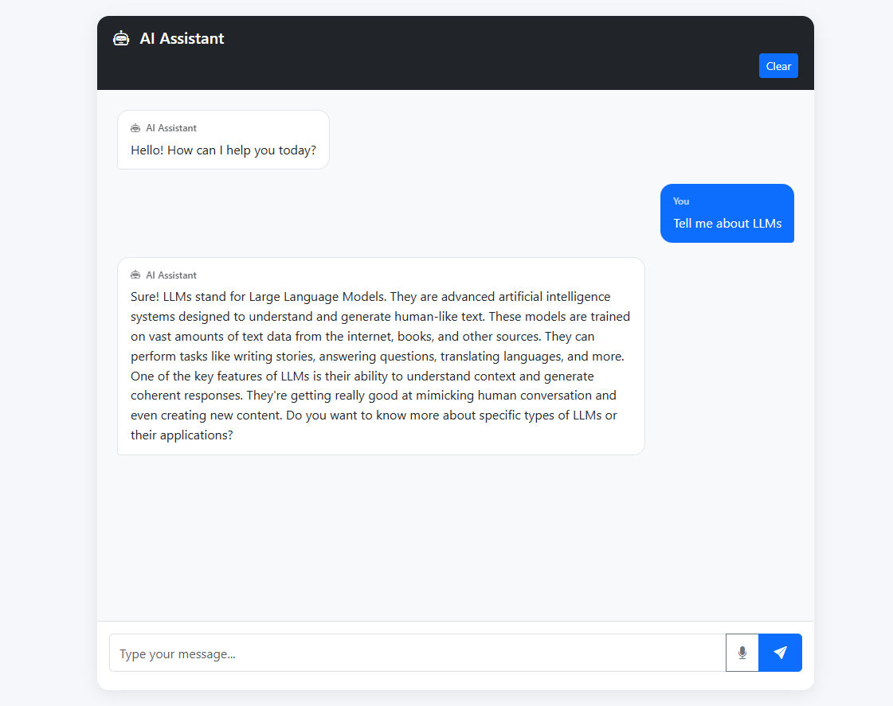
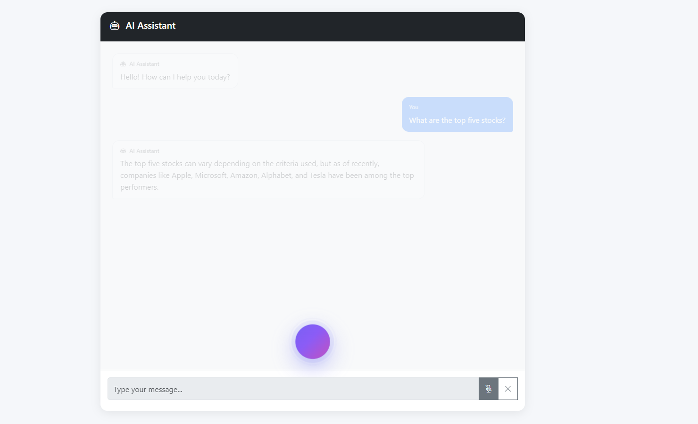
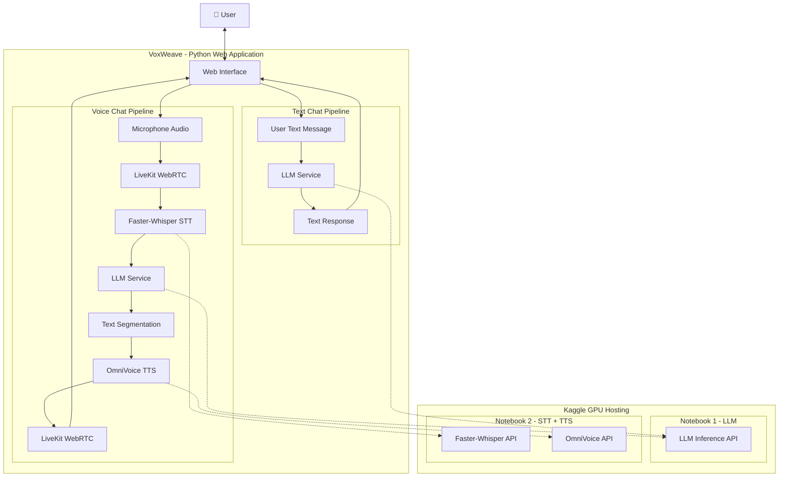
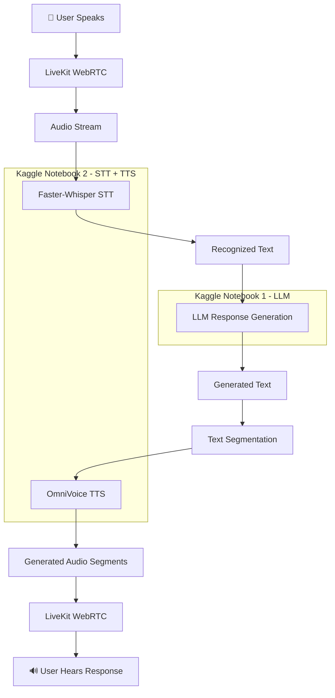
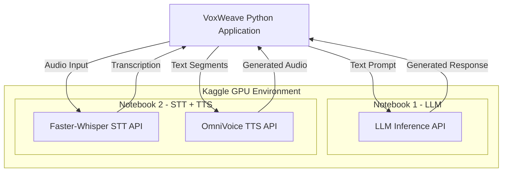

# 🎙️ VoxWeave
### Open-Source Multimodal AI Assistant

**An open-source AI assistant that brings text and real-time voice conversations together using LLMs, Speech-to-Text, Text-to-Speech, and WebRTC.**

Build your own AI-powered conversational assistant with open-source technologies. VoxWeave supports traditional text-based conversations and real-time voice interactions, with AI models hosted independently through Kaggle GPU notebooks.

<p align="center">
  
  
  
  
  
  
</p>


## ✨ What is VoxWeave?

VoxWeave is a Python-based conversational AI application that provides two ways to interact with an AI assistant.

**1.💬 Text Chat**

Have conversations with an LLM through a traditional chat interface. Send messages and receive AI-generated textual responses.
<p align="center">
  
</p>

**2.🔊 Real-Time Voice Chat**

Talk naturally with the AI assistant using your microphone and receive spoken responses in real time.

The voice pipeline uses speech recognition to understand your message, an LLM to generate a response, and text-to-speech to convert the response into audio.

Unlike solutions that rely entirely on commercial AI APIs, VoxWeave is designed around open-source components. Its AI models can run independently on GPU-backed environments, including Kaggle notebooks.

<p align="center">
  
</p>

## 🚀 Features

| Feature | Description |
|---|---|
| 💬 Text Chat | Interactive conversations with an LLM |
| 🎙️ Voice Conversations | Talk to the AI using your microphone |
| ⚡ Real-Time Communication | WebRTC-based audio communication |
| 📝 Speech Recognition | Convert spoken audio into text |
| 🧠 LLM Integration | Generate intelligent conversational responses |
| 🔊 Text-to-Speech | Convert AI responses into natural-sounding speech |
| ✂️ Text Segmentation | Split long AI responses into smaller speech segments |
| 🔄 Streaming Audio | Send generated speech segments to the user progressively |
| ☁️ GPU Model Hosting | Host AI models using Kaggle GPU notebooks |
| 🧩 Modular Architecture | Independently configure LLM, STT, and TTS services |
| 🐍 Python Backend | Built with Python 3.12.10 |

## 🏗️ Architecture

VoxWeave has two independent conversational pipelines that share the same application backend and LLM capabilities.

### High-Level Architecture



### 🎙️ Voice Conversation Workflow

The voice pipeline is designed to deliver a natural conversational experience.



**Why text segmentation?**

Instead of waiting for the entire LLM response before generating audio, VoxWeave splits the response into smaller text segments.

Each segment can be passed to the TTS service independently. This helps reduce perceived response latency and allows users to hear the beginning of a response while subsequent segments are being generated.

## 🛠️ Technology Stack

VoxWeave combines several open-source technologies.

| Component | Technology | Purpose |
|---|---|---|
| Backend | Python 3.12.10 | Application backend |
| LLM | Configurable LLM | Conversational intelligence |
| Speech-to-Text | Faster-Whisper (large-v3-turbo) | Audio transcription |
| Text-to-Speech | OmniVoice | Speech generation |
| Real-Time Communication | LiveKit | WebRTC audio communication |
| GPU Hosting | Kaggle Notebooks | AI model inference |
| Containerization | Docker Compose | LiveKit deployment |
| Dependency Management | pip / venv | Python environment |

The architecture is modular, so individual AI components can be replaced with other compatible open-source models.

## 📋 Prerequisites

Before installing VoxWeave, make sure you have:

- Python **3.12.10**
- Git
- Docker and Docker Compose
- A Kaggle account with access to GPU notebooks
- A modern web browser with microphone access
- Internet connectivity between the application and hosted AI services

## ⚙️ Installation & Setup

Follow these steps to get VoxWeave running locally.

### 1. Clone the repository

```bash
git clone https://github.com/khalilsaqib/VoxWeave.git

cd voxweave
```

### 2. Create a virtual environment

Make sure Python 3.12.10 is installed.

Verify your Python version:

```bash
python --version
```

Expected output:

```text
Python 3.12.10
```

Create the virtual environment:

**Windows:**

```powershell
py -3.12 -m venv .venv
```

**Linux / macOS:**

```bash
python3.12 -m venv .venv
```

### 3. Activate the virtual environment

**Windows PowerShell:**

```powershell
.venv\Scripts\Activate.ps1
```

**Windows CMD:**

```cmd
.venv\Scripts\activate.bat
```

**Linux / macOS:**

```bash
source .venv/bin/activate
```

### 4. Install dependencies

Upgrade pip:

```bash
python -m pip install --upgrade pip
```

Install the project dependencies:

```bash
pip install -r requirements.txt
```

Your Python environment is now ready.

## ☁️ AI Model Deployment Using Kaggle

VoxWeave uses two Kaggle notebooks to host its AI inference services.

Both notebooks must be running before starting the application.

### Available Notebooks

| Notebook | Models | Purpose |
|---|---|---|
| LLM Notebook | LLM | Hosts the language model for response generation |
| STT + TTS Notebook | Faster-Whisper + OmniVoice | Hosts speech recognition and speech synthesis services |

### Deployment Steps

**Step 1: Deploy the LLM**

1. Sign in to your Kaggle account.
2. Navigate to the LLM notebook in the `notebooks` directory.
3. Import or upload the notebook into Kaggle.
4. Enable GPU acceleration in the notebook settings.
5. Execute the notebook.
6. Wait until the LLM service initializes successfully.
7. Copy the public URL exposed by the notebook.

**Step 2: Deploy STT and TTS**

1. Open the STT + TTS notebook in the `notebooks` directory.
2. Import or upload the notebook into Kaggle.
3. Enable GPU acceleration.
4. Execute the notebook.
5. Wait until both Faster-Whisper and OmniVoice services initialize successfully.
6. Copy the public URLs exposed by the notebook.

> **Important:** Depending on how the notebook exposes its services, the STT and TTS endpoints may use separate public URLs. Configure both independently if that is how your notebook is set up.

### Kaggle Deployment Architecture



**Kaggle Hosting Notes:**

- Both notebooks must remain active while using VoxWeave.
- Kaggle GPU sessions are temporary and subject to Kaggle usage limits.
- Public URLs can change when notebooks restart or sessions expire.
- Update your environment configuration whenever a public URL changes.
- Avoid exposing sensitive credentials through public notebook outputs.

## 🔧 Configure Environment Variables

After running both Kaggle notebooks, you must update the public service URLs in your application's `.env` file.

Example configuration:

```env
# LLM Service - Kaggle Notebook 1
BASE_LLM_URL=YOUR_LLM_KAGGLE_PUBLIC_URL

# STT Service - Kaggle Notebook 2
STT_WS_URL=YOUR_STT_KAGGLE_PUBLIC_URL

# TTS Service - Kaggle Notebook 2
TTS_WS_URL=YOUR_TTS_KAGGLE_PUBLIC_URL

# LiveKit Configuration
LIVEKIT_URL=YOUR_LIVEKIT_URL
LIVEKIT_API_KEY=YOUR_LIVEKIT_API_KEY
LIVEKIT_API_SECRET=YOUR_LIVEKIT_API_SECRET
```

**Important:**

- Replace the placeholder URLs with the actual public URLs from your Kaggle notebooks.

## 🎧 Start LiveKit Server

VoxWeave uses LiveKit for real-time audio communication between the browser and Python application.

A Docker Compose configuration is included in the repository.

Make sure Docker Desktop or Docker Engine with Docker Compose is installed and running.

From the repository root, execute:

```bash
docker compose -f docker_compose/livekit_compose.yaml up -d
```

This starts the LiveKit services in detached mode.

### Verify LiveKit

Check running containers:

```bash
docker compose -f docker_compose/livekit_compose.yaml ps
```

View container logs:

```bash
docker compose -f docker_compose/livekit_compose.yaml logs -f
```

Stop LiveKit:

```bash
docker compose -f docker_compose/livekit_compose.yaml down
```

> **Note:** Configure your LiveKit environment variables and connection URL according to the supplied Compose configuration and your application settings. Make sure the required ports are accessible to the browser and application.

## ▶️ Run the Application

Before starting VoxWeave, ensure that:

- Your Python virtual environment is activated.
- All Python dependencies are installed.
- The LLM Kaggle notebook is running.
- The STT + TTS Kaggle notebook is running.
- The public Kaggle URLs are updated in your `.env` file.
- The LiveKit server is running through Docker Compose.

Start the application:

```bash
python -m app.main
```

Open the local application URL displayed in your terminal.

You can now:

- Start a textual conversation with the LLM.
- Enable voice chat.
- Speak through your microphone.
- Receive AI-generated spoken responses.

## 🌱 Contributing

Contributions are welcome!

If you have ideas for improvements, additional model integrations, performance optimizations, or new conversational features, feel free to contribute.

### How to contribute

1. Fork this repository.
2. Create a new feature branch.
3. Make your changes.
4. Test your implementation.
5. Submit a Pull Request.

```bash
git checkout -b feature/your-feature-name

git add .

git commit -m "Add: your feature description"

git push origin feature/your-feature-name
```


## ⭐ Why VoxWeave?

The goal of VoxWeave is to make it easier for developers to understand and build complete AI conversational systems.

Rather than focusing on just one model or API, this project demonstrates how multiple open-source components can work together to create a complete text and voice AI experience.

Whether you're learning about LLMs, experimenting with speech recognition, exploring text-to-speech, or building your own real-time AI assistant, VoxWeave provides a practical starting point.

If you find this project useful, consider giving it a ⭐ on GitHub!

## 📄 License

This project is licensed under the **MIT License**.

You are free to use, modify, distribute, and build upon this project in accordance with the terms of the MIT License.

See the [LICENSE](LICENSE) file for details.

---

<p align="center">
  <b>VoxWeave — Weaving Conversations with AI.</b>
  <br/>
  Built with ❤️ using Open-Source Technologies.
</p>

**Keywords:** Open Source AI, Python AI Assistant, Multimodal AI, Voice AI, Conversational AI, Real-Time Voice Assistant, LLM Integration, Faster-Whisper, OmniVoice, LiveKit, WebRTC, Speech-to-Text, Text-to-Speech, Kaggle GPU, Python Chatbot, AI Voice Agent, Self-Hosted AI.
